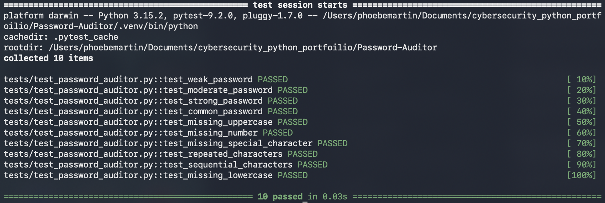
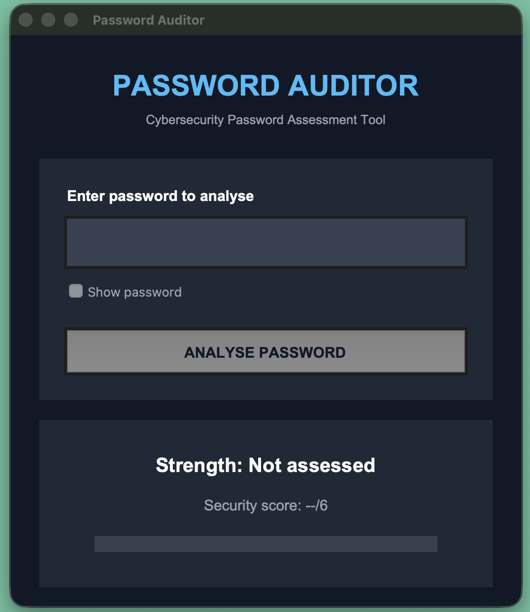

A Python based password strength auditing tool that evaluates passwords agasint a range of security criteria and provides feedback to help users identify potential weaknesses.

The project includes a GUI, password analysis logic and automated tests using Pytest.

## Screenshots

--- Features: ---
- Password strength assessment
- Length validation
- Character validation
- Common password detection
- Repeated character detection
- Sequential character detection
- Feedback
- Graphical interface
- Automated testing

--- Technologies used: ---
- Python 3
- Tkinter
- Pytest
- Git & Github

--- Project Structure: ---

Password-Auditor/
    main.py
    gui.py
    README.md
    screenshots/
        password_auditor.png
        test_results_password_auditor.png
    tests/
        test_password_auditor.py

--- Requirements: ---
- Python 3
- Tkinter
- Pytest

--- TESTS: ---
currently 10/10 pass

--- Security limitations: ---
- Passwords are analysed locally
- Common password detection feature uses predefined list
- Scoring system is an educational assessment and provides no guarantees
- Tool does not check passwords against known data breaches

--- Future Improvements: ---
- Integration with larger common-password database
- Password entropy estimation
- Improved GUI design
- Additional automated tests
